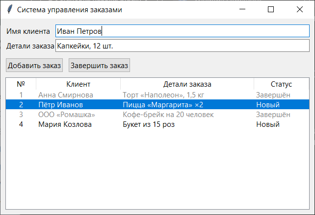

# order-system
demo для командной разработки: система управления заказами для малого бизнеса

### Задачи, которые перед нами стоят:

Сделать систему управления заказами для малого бизнеса, создать возможность

* добавлять заказ;
* завершать заказ.



## Что умеет программа

- **Добавить заказ** — имя клиента и детали заказа сохраняются в базу со статусом «Новый». Пустые поля не принимаются. Enter в поле «Детали заказа» тоже добавляет заказ.
- **Завершить заказ** — выбрать строку в таблице и нажать кнопку: статус меняется на «Завершён», строка становится серой. Если заказ не выбран — предупреждение; если уже завершён — сообщение.
- **Таблица заказов** обновляется после каждого действия.

## Технологии

- Python 3.10+ (проверено на 3.13)
- `tkinter` и `ttk` — окно программы
- `sqlite3` — база `business_orders.db` (создаётся рядом с `main.py` при первом запуске, в git не попадает)

Сторонние библиотеки не нужны — всё входит в стандартную поставку Python.

## Запуск

```bash
python main.py
```

Тесты:

```bash
python -m unittest -v
```

## Как велась командная работа

| Разработчик | Задача | Как попало в `main` |
|---|---|---|
| [IrinaZeroDev](https://github.com/IrinaZeroDev) | База данных, окно, добавление и список заказов | Ветка `dev` → merge commit в `main` |
| [Irina-64](https://github.com/Irina-64) (collaborator) | Завершение заказа | Ветка `feature/complete-order` → pull request #1 → ревью и слияние |

Оба аккаунта принадлежат одному автору: командная работа смоделирована для учебного задания урока «Командная разработка».

## Чем код отличается от урока

- **Соединение с базой закрывается всегда** (`contextlib.closing`), даже если запрос упал с ошибкой, — иначе файл базы может остаться заблокированным.
- **Коммит через `with conn`**: изменения сохраняются, только если запрос выполнился без ошибок.
- **Данные передаются через `?`**, а не f-строкой, — защита от SQL-инъекций (есть тест).
- **Нельзя добавить пустой заказ** и повторно завершить уже завершённый.
- **Работа с базой отделена от окна**: функции `add_order`, `complete_order`, `get_orders` можно проверять тестами без интерфейса.

## Лицензия

[MIT](LICENSE)
